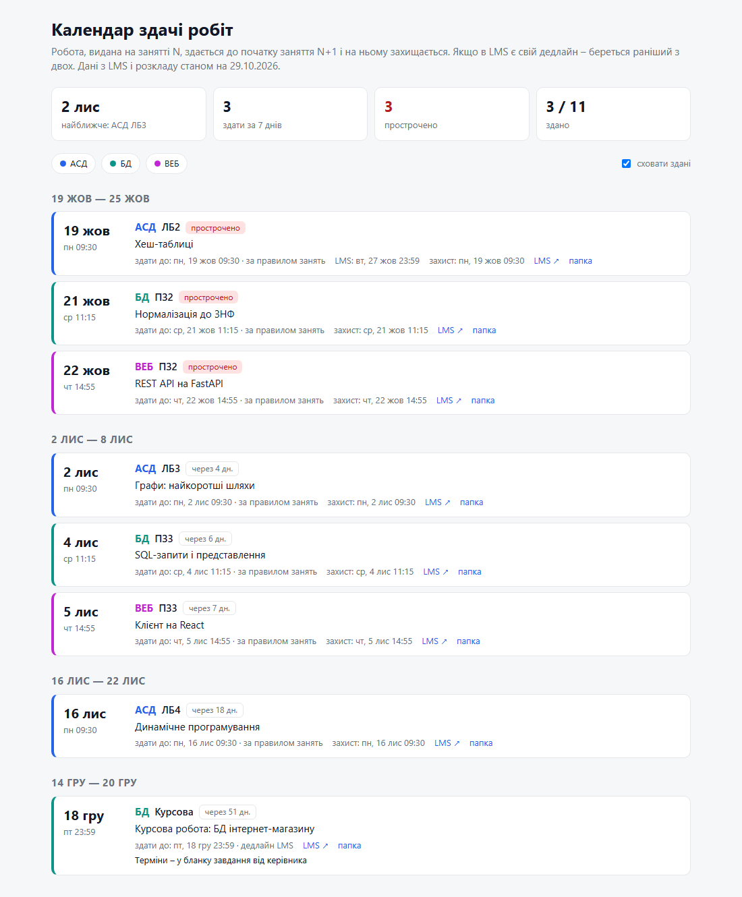
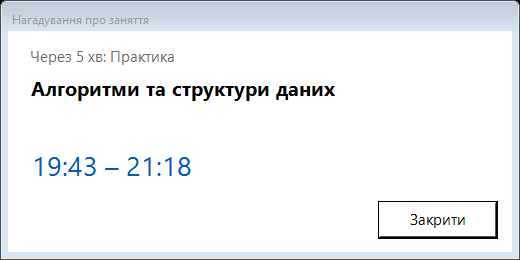
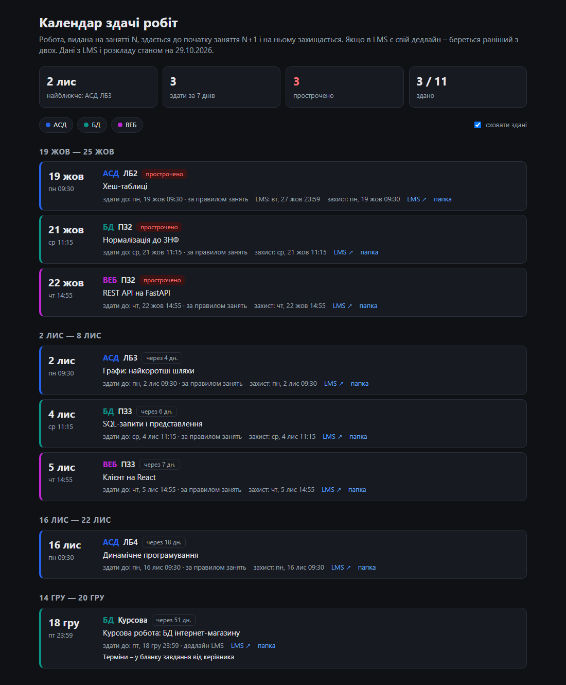

# semester-kit

**Claude Code skills that organize a university semester and help you *learn* it – not do it for you.**

[Українською](README.uk.md)

semester-kit turns an empty folder into a study workspace: one folder per course with its materials and an
AI-readable `CLAUDE.md` (grading rules, which of several methodical guides is actually current, assignments,
report requirements), a deadline calendar synced from Moodle, a grade tracker with GPA, and a desktop reminder
before every class. On top of that, Claude helps you prepare for each assignment, check your draft against the
grading criteria, and rehearse the defense.

Built by a Computer Science student at Kharkiv National University of Radio Electronics (NURE) and tested on
NURE's Moodle (`dl.nure.ua`) and CIST timetable; designed to work with any Moodle and any `.ics` timetable.

<p align="center"></p>
<p align="center"><sub>Deadline calendar (light/dark theme, filters by course) and the class reminder popup.
Generated from the fictional <a href="examples/demo">demo workspace</a> (<code>python examples/make_demo.py</code>).</sub></p>
<p align="center">&nbsp;&nbsp;</p>

## Skills

| Skill | What it does |
|---|---|
| `/semester-init` | Profile, timetable, course folders with materials and `CLAUDE.md`, assignments, calendar, grades, reminder |
| `/semester-sync` | Pulls deadlines, submission status, new assignments and grades from Moodle; rebuilds the calendar |
| `/work-prep` | Assignment spec (task, criteria, report checklist, open questions), a theory plan for `/learn`, an empty report skeleton with correct formatting |
| `/criteria-check` | Reviews *your* draft against the grading criteria and report requirements: what's present, missing or wrong, and where |
| `/defense-prep` | Defense cheat sheet (demo steps, "where in your code is…", theory) and mock oral exam |
| `/grades` | Grades from Moodle + final grades you enter, average and ECTS-credit-weighted GPA, national/ECTS scale |
| `/class-reminder` | Always-on-top popup 5 minutes before each class (Windows Task Scheduler) |

What you get in the workspace:

- `calendar.html` / `calendar.ics` – deadlines by week, overdue and "due in N days" badges; import into Google/Outlook.
  Rule of thumb built in: work given at class N is due before class N+1 (where it's defended); an earlier LMS
  deadline wins.
- `<course>/CLAUDE.md` – the course "spec" every Claude session reads first.
- `_grades/Оцінки.md` – grade table, average, credit-weighted average, forecast.
- Report skeleton (`_tools/report_base.py`): python-docx with DSTU-like layout, title page from your profile,
  real Word equations from LaTeX, PDF via Word.

## Academic integrity

semester-kit is a study assistant. `/work-prep` gives you a spec and an *empty* skeleton, `/criteria-check`
reviews work *you* wrote, `/defense-prep` makes sure you understand it. Follow your university's and each course's
policy on AI use, and disclose it where required. You are responsible for what you submit.

## Requirements

- Windows 10/11, [Claude Code](https://claude.com/claude-code) (the Claude desktop app's Code tab works)
- Python 3.10+ (`pip install python-docx pymupdf openpyxl python-pptx latex2mathml lxml`)
- Microsoft Word (PDF export and equations)
- Claude in Chrome extension – Claude reads Moodle in your own logged-in browser. It goes slowly, one page at a
  time, and never bypasses login or "are you human" checks: you do those. Make sure automated access is
  acceptable under your LMS's rules.

## Install

```powershell
git clone https://github.com/<you>/semester-kit
cd semester-kit
.\install.ps1          # copies skills\* to %USERPROFILE%\.claude\skills
```

Restart Claude, create an empty folder for the semester (not under `AppData`), open a Claude Code session there
and run `/semester-init`.

## Adapters

- **LMS:** Moodle 4.5+/5.x (uses the *Activities overview* and *User grades* report pages). Older Moodle: sync falls
  back to reading assignment pages.
- **Timetable:** NURE CIST `TimeTable_*.xls` (`_tools/timetable/cist_nure.py`) or any `.ics`
  (`_tools/timetable/ics.py`). Another format → write a converter to the same `schedule.json` (list of
  `{start, end, abbr, name, kind}`).
- **Grading scale and report style:** `SCALE` in `_tools/grades.py`; university, department and city in `_profile.json`.

## Sharing course knowledge

Classmates can share their analysed course folders (a "group pack") privately; `/semester-init` can start from one.
Don't publish group packs: they contain course materials (copyrighted) and teachers' data.

## Lessons learned (Windows)

The Claude desktop app is a packaged (MSIX) app: files its sessions write under `%LOCALAPPDATA%` are redirected
into the app's private store and are invisible to the rest of Windows, and processes started from a session die
when the app restarts. semester-kit therefore keeps everything in your profile folder and starts the reminder
from Task Scheduler.

## License

MIT – see [LICENSE](LICENSE).
