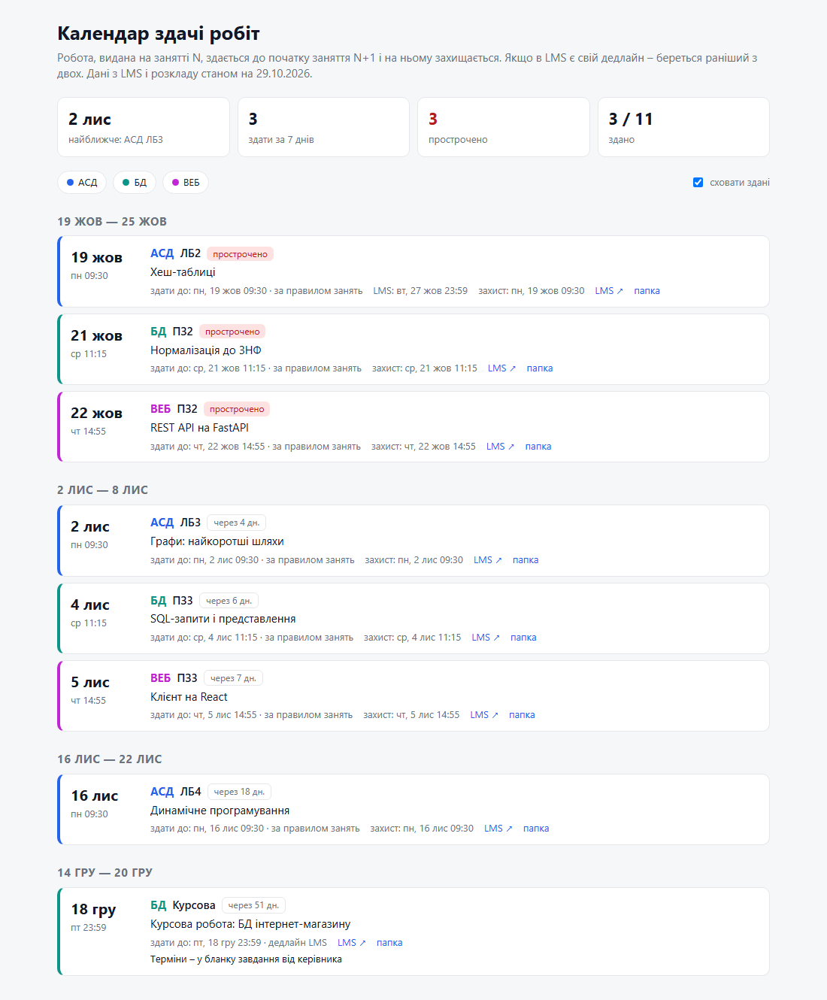
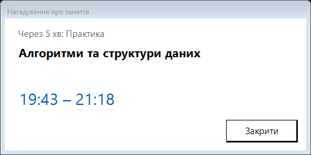
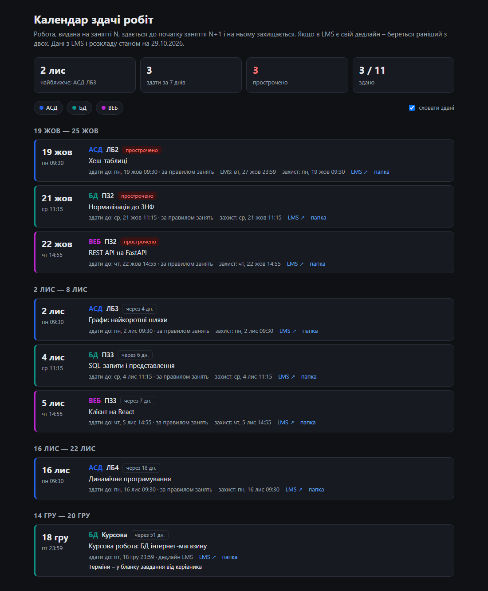

# semester-kit

**Скіли для Claude Code, які організовують семестр і допомагають його *вивчити*, а не виконують роботи за вас.**

[English](README.md)

semester-kit перетворює порожню теку на навчальний воркспейс:
- тека на кожну дисципліну з матеріалами і `CLAUDE.md` для ШІ: правила оцінювання, яка з кількох методичок
  актуальна, роботи, вимоги до звітів;
- календар дедлайнів із синхронізацією з Moodle;
- облік оцінок із середнім балом;
- нагадування перед кожною парою.

Далі Claude допомагає підготуватися до кожної роботи, перевірити вашу чернетку за критеріями і потренуватися до захисту.

Зроблено студентом ХНУРЕ (Комп'ютерні науки). Перевірено на DL ХНУРЕ (Moodle) і розкладі CIST. Працює з будь-яким
Moodle і будь-яким розкладом у `.ics`.

<p align="center"></p>
<p align="center"><sub>Календар здачі (світла/темна тема, фільтри за дисциплінами) і вікно нагадувача.
Згенеровано з вигаданого <a href="examples/demo">демо-воркспейсу</a> (<code>python examples/make_demo.py</code>).</sub></p>
<p align="center">&nbsp;&nbsp;</p>

## Скіли

| Скіл | Що робить |
|---|---|
| `/semester-init` | профіль, розклад, теки дисциплін з матеріалами й `CLAUDE.md`, роботи, календар, оцінки, нагадувач |
| `/semester-sync` | дедлайни, статуси здачі, нові завдання й оцінки з Moodle; перебудова календаря |
| `/work-prep` | специфікація роботи (завдання, критерії, чекліст звіту, питання до викладача), план теорії для `/learn`, порожній каркас звіту з правильним оформленням |
| `/criteria-check` | перевірка *вашої* чернетки за критеріями і вимогами до звіту: що є, чого бракує, що неправильно і де |
| `/defense-prep` | шпаргалка до захисту (що показати, «де у вас…», теорія) і тренування питаннями |
| `/grades` | оцінки з Moodle і підсумкові з відомості; середній бал і зважений за кредитами ЄКТС, національна шкала / ЄКТС |
| `/class-reminder` | вікно поверх усіх за 5 хв до пари (Планувальник Windows) |

## Академічна доброчесність

semester-kit – помічник у навчанні:
- `/work-prep` дає специфікацію і *порожній* каркас;
- `/criteria-check` перевіряє написане *вами*;
- `/defense-prep` допомагає переконатися, що ви розумієте свою роботу.

Дотримуйтеся політики ЗВО і кожної дисципліни щодо ШІ та зазначайте його використання, де цього вимагають.
За те, що здаєте, відповідаєте ви.

## Встановлення

Потрібно:
- Windows 10/11 і Claude Code (вкладка Code у застосунку Claude);
- Python 3.10+;
- Microsoft Word;
- розширення Claude in Chrome.

Claude читає Moodle у вашому браузері під вашим логіном, повільно, по одній сторінці. Вхід і перевірку «я не робот»
проходите ви. Переконайтеся, що правила вашої LMS це дозволяють.

```powershell
git clone https://github.com/DmytroBabarytskyi/semester-kit
cd semester-kit
.\install.ps1
```

Перезапустіть Claude і створіть порожню теку семестру (не в `AppData`). Відкрийте в ній сесію Claude Code і напишіть `/semester-init`.

## Пакети груп

Одногрупники можуть приватно ділитися розібраними дисциплінами, і `/semester-init` вміє з них стартувати.
Не публікуйте пакети: у них матеріали курсів (авторське право) і дані викладачів.

## Ліцензія

MIT – див. [LICENSE](LICENSE).
